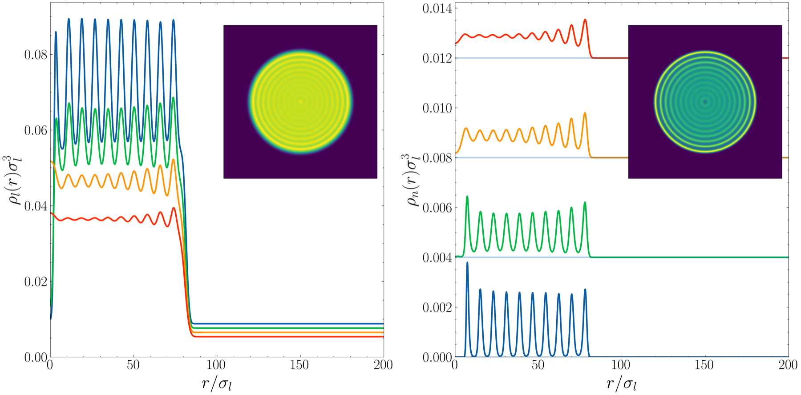
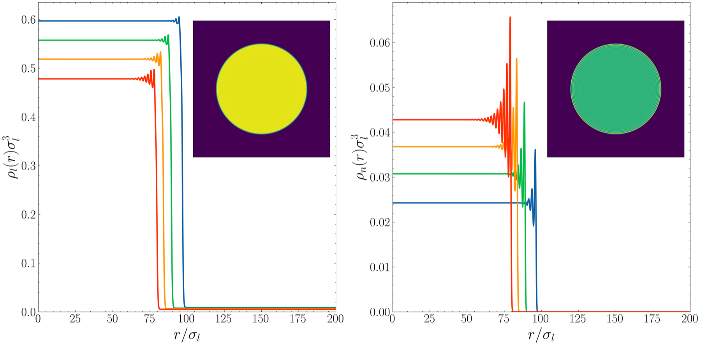
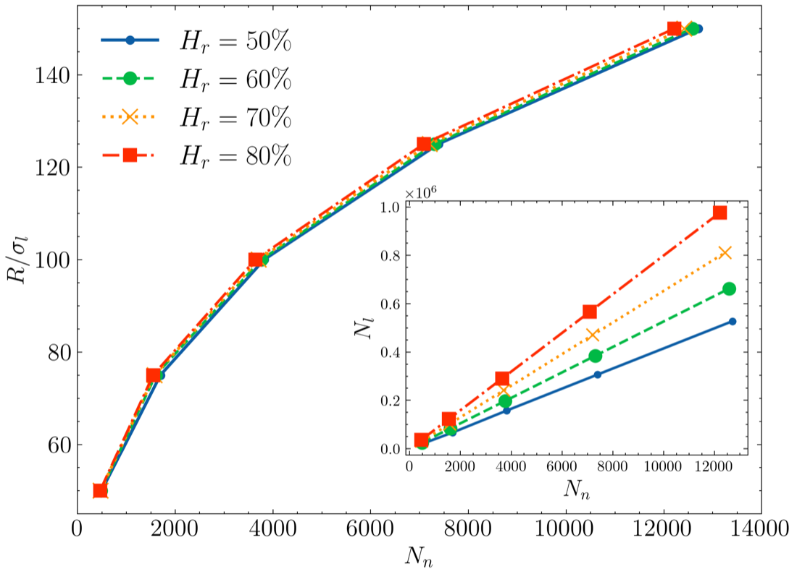
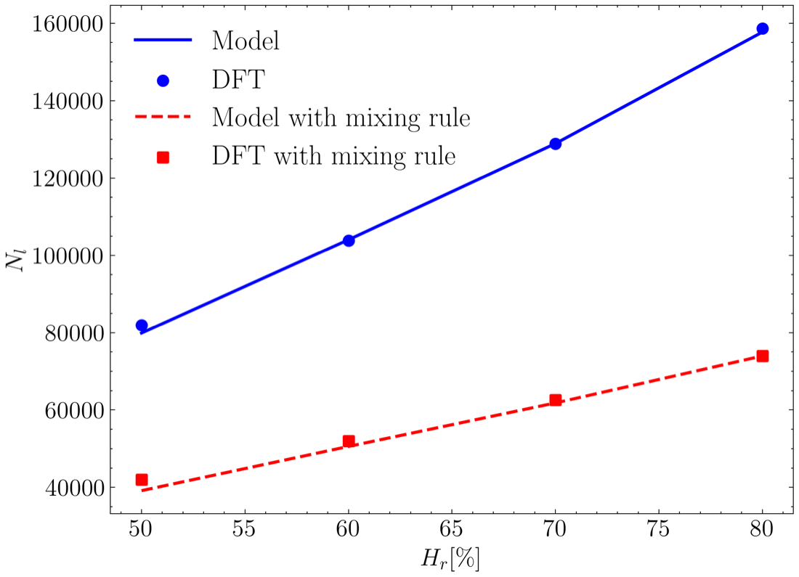

# Laden-Droplet

Classical density functional theory (DFT) code for **nanoparticle-laden droplets**, i.e. liquid droplets
that are stabilised against evaporation by non-volatile solute particles dissolved in them.

This is the code behind

> M. Gül, A. J. Archer, B. D. Goddard and R. Roth,
> *Classical density functional theory for nanoparticle-laden droplets*,
> J. Chem. Phys. **163**, 114111 (2025). [doi:10.1063/5.0292718](https://doi.org/10.1063/5.0292718)

which extends the lattice-DFT study of A. J. Archer, B. D. Goddard and R. Roth,
J. Chem. Phys. **159**, 194503 (2023), to continuum DFT.

<p align="center">
  
</p>
<p align="center"><sub>Solvent (left) and nanoparticle (right) density profiles of a stable 10:1 droplet at 50–80 % relative humidity.
See <a href="#results">Results</a>.</sub></p>

---

## Theoretical background

### Why laden droplets can be stable

A droplet of a pure liquid surrounded by its vapour is thermodynamically unstable: because of its curved
interface the pressure inside exceeds the pressure outside by the Laplace pressure,

$$P_\mathrm{in} - P_\mathrm{out} = \frac{2\gamma}{R},$$

so mechanical equilibrium cannot be reached and the droplet evaporates – faster and faster as $R$ shrinks.
If non-volatile nanoparticles (solutes, virions, …) are dissolved in the droplet, their attraction to the
liquid lowers the pressure inside the droplet. This can compensate the Laplace pressure, and the droplet
attains a finite equilibrium radius even when the surrounding air is *undersaturated*, i.e. at a relative
humidity $H_r$ below 100%.

### Model: binary square-well mixture

The system is modelled as a binary mixture of hard spheres with square-well (SW) attractions,

$$
\phi_{ij}(r) =
\begin{cases}
\infty, & r < \sigma_{ij},\\
-\varepsilon_{ij}, & \sigma_{ij} \le r \le \lambda_{ij}\sigma_{ij},\\
0, & \text{otherwise},
\end{cases}
$$

where component 1 is the **liquid/solvent** ($l$) and component 2 the **nanoparticles** ($n$). The size
ratio is $q = \sigma_l/\sigma_n$ (a "10:1 droplet" has $\sigma_n = 10\sigma_l$). The cross-interaction range
follows the Lorentz mixing rule $\lambda_{ln} = (\lambda_{ll}\sigma_l + \lambda_{nn}\sigma_n)/(\sigma_l + \sigma_n)$;
the cross-interaction strength $\varepsilon_{ln}$ can be chosen freely or via $\varepsilon_{ln} = \sqrt{\varepsilon_{ll}\varepsilon_{nn}}$.

The Helmholtz free-energy functional is split into an exact ideal-gas part, a hard-sphere part from
**fundamental measure theory (FMT)** – by default the **White Bear** functional – and a **mean-field
(RPA)** treatment of the square-well attractions:

$$
F_\mathrm{ex}[\rho_l,\rho_n] = F_\mathrm{hs}[\rho_l,\rho_n] +
\frac{1}{2} \sum_{i,j} \iint \rho_i(\mathbf{r}) \rho_j(\mathbf{r}') \phi^{(ij)}_\mathrm{sw}(|\mathbf{r}-\mathbf{r}'|) d\mathbf{r} d\mathbf{r}' .
$$

With $\beta\varepsilon_{ll} = 1.2$ and $\lambda_{ll} = 1.5$ the pure SW fluid has liquid–vapour coexistence at
packing fractions $\eta_l = 0.380225$ and $\eta_v = 0.005861$; these are the reference values used for the solvent.

### Semi-grand canonical ensemble

The liquid is treated **grand canonically** at a fixed chemical potential $\mu_0 \le \mu_c$, which sets the
relative humidity of the environment,

$$H_r = 100 \times \frac{P(\mu_0)}{P(\mu_c)} .$$

The nanoparticles are non-volatile and are treated **canonically**, i.e. their number $N_n = \int \rho_n(\mathbf{r}) d\mathbf{r}$
is held fixed. This constraint is enforced with a Lagrange multiplier $\mu_n$, which gives the semi-grand potential functional

$$
\Omega[\rho_l,\rho_n] = F[\rho_l,\rho_n] + \int \rho_l(\mathbf{r}) \left( V^{l}_\mathrm{ext}(\mathbf{r}) - \mu_0 \right) d\mathbf{r} + \int \rho_n(\mathbf{r}) V^{n}_\mathrm{ext}(\mathbf{r}) d\mathbf{r} - \mu_n \left( \int \rho_n(\mathbf{r}) d\mathbf{r} - N_n \right),
$$

with the intrinsic free energy $F = F_\mathrm{id} + F_\mathrm{ex}$ and the ideal-gas part

$$
F_\mathrm{id}[\rho_l,\rho_n] = k_B T \sum_{i=l,n} \int \rho_i(\mathbf{r}) \left( \ln\left(\Lambda_i^3 \rho_i(\mathbf{r})\right) - 1 \right) d\mathbf{r} .
$$

Setting $\delta\Omega/\delta\rho_l = \delta\Omega/\delta\rho_n = 0$ and $\partial\Omega/\partial\mu_n = 0$ gives

$$
\rho_l(r) = \Lambda_l^{-3} \exp\left( \beta\mu_0 + c_l^{(1)}(r) - \beta V^{l}_\mathrm{ext}(r) \right), \qquad
\rho_n(r) = N_n \frac{\exp\left( c_n^{(1)}(r) - \beta V^{n}_\mathrm{ext}(r) \right)}{\int \exp\left( c_n^{(1)}(\mathbf{r}') - \beta V^{n}_\mathrm{ext}(\mathbf{r}') \right) d\mathbf{r}'} ,
$$

with the one-body direct correlation functions $c_i^{(1)} = -\delta\beta F_\mathrm{ex}/\delta\rho_i$. Assuming spherical
symmetry, all density profiles are functions of the radial coordinate $r$ only. Without external potentials,
and with the prefactors written in terms of reference bulk densities $\rho_i^{(0)}$, these become Eq. (13) of the paper:

$$
\rho_l(r) = \rho_l^{(0)} \exp\left(c_l^{(1)}(r) + \beta\mu_l\right), \qquad
\rho_n(r) = \rho_n^{(0)} \exp\left(c_n^{(1)}(r)\right).
$$

**What the Lagrange multiplier means.**

* $\mu_n$ is *not* an input parameter. It is fixed by the constraint $\int \rho_n d\mathbf{r} = N_n$, which removes it
  from the nanoparticle equation above: only the normalisation remains.
* At the minimum, $\mu_n = \partial F/\partial N_n$ is the chemical potential of the nanoparticles. It has the same value
  everywhere in the system, so the nanoparticles inside and outside the droplet are in chemical equilibrium
  (the second condition of the thermodynamic model in Sec. II C of the paper).
* The two components play different roles. The imposed $\mu_0$ lets solvent particles exchange with the
  surrounding vapour, which is how the humidity enters. The constraint stops nanoparticles from being lost
  to the vapour, as would happen if they were also treated grand canonically.
* In the code the multiplier never appears explicitly. After each Picard or Ng update, $\rho_n$ is rescaled by
  $N_n / \int \rho_n d\mathbf{r}$ (the `rho2[i] *= (double)Nn/c` lines in `sp_one.c`). This rescaling is exactly the
  normalisation that $\mu_n$ imposes, so the arbitrary prefactor $\rho_n^{(0)}$ drops out.
* The external potential $V^{n}_\mathrm{ext}$ is used only in the first stage of the minimisation below, where
  it holds the nanoparticles together. In all other stages both external potentials are zero.

### Numerical minimisation

For strongly asymmetric mixtures the plain Picard iteration becomes unstable, because
$\exp(c_n^{(1)})$ grows very large. The solver therefore uses four stages (Sec. II B of the paper):

1. **Nanoparticles only.** $\rho_n$ is relaxed inside a sigmoidal effective potential
   $V_\mathrm{ext}(r) = V_\mathrm{in} + (V_\mathrm{out}-V_\mathrm{in})/(1+e^{-a(r-R)})$ that is attractive
   inside and repulsive outside the droplet.
2. **Liquid only.** $\rho_l$ is relaxed in the fixed background of $\rho_n$, starting from a step profile
   (liquid density inside, vapour density outside).
3. **Coupled Picard iteration** with mixing parameters $\alpha_l$ and
   $\alpha_n = \tilde\alpha_n \exp(-\max_r |c_n^{(1)}(r)|)$.
4. **Ng acceleration** (K.-C. Ng, J. Chem. Phys. **61**, 2680 (1974)) until convergence.

After every update $\rho_n$ is rescaled to keep $N_n$ fixed.

---

## Results

A few results from the paper, computed with this code. In the density plots the colours denote the relative
humidity: $H_r$ = 50% (red), 60% (green), 70% (orange) and 80% (blue). The insets show 2D cuts through the droplet
at $H_r$ = 50%.

### 2:1 droplet

<p align="center"></p>

Solvent density $\rho_l(r)$ (left) and nanoparticle density $\rho_n(r)$ (right) for a 2:1 droplet
($\beta\varepsilon_{nn} = 0$, $\beta\varepsilon_{ln} = 3.78$, $\lambda_{nn} = 1.01$, $N_n$ = 92 281; paper Fig. 3).
The droplet is stable at all humidities, with radius $R \approx 80\sigma_l$ at $H_r$ = 50%, and grows as the
humidity increases. The nanoparticles accumulate at the liquid–vapour interface.

### 10:1 droplet

<p align="center"></p>

The same for a 10:1 droplet ($\beta\varepsilon_{ln} = 3.69$, $N_n$ = 1983; paper Fig. 4), the case closer to
viruses suspended in water droplets. The nanoparticle profiles are offset vertically for clarity (light blue
baselines). Under the strong spherical confinement, both solvent and nanoparticles order into concentric shells.

### Droplet size and comparison with the thermodynamic model

<p align="center">
  
  
</p>

**Left:** equilibrium radius $R$ of the 10:1 droplet as a function of the number of nanoparticles $N_n$
(inset: number of liquid particles $N_l$; paper Fig. 5). More nanoparticles stabilise a larger droplet.
**Right:** number of liquid particles $N_l$ in the 10:1 droplet versus humidity. The DFT results (symbols) agree
closely with the simple thermodynamic model based on mechanical and chemical equilibrium (lines), both without and
with the energy mixing rule $\varepsilon_{ln} = \sqrt{\varepsilon_{ll}\varepsilon_{nn}}$ (paper Fig. 8).

<sub>Figures from M. Gül *et al.*, J. Chem. Phys. **163**, 114111 (2025), [doi:10.1063/5.0292718](https://doi.org/10.1063/5.0292718).</sub>

---

## Repository layout

| File | Content |
|---|---|
| `sp_one.c` | Main solver: radial grid, weighted densities, Euler–Lagrange equations, the minimisation stages above, output. All model parameters are set here. |
| `white_bear.c` | White Bear FMT functional (Roth *et al.* 2002; Yu & Wu 2002). **Used in the paper.** |
| `white_bear_q3.c` | White Bear variant with the $(1-\xi^2)^q$ ($q=3$) correction of the $n_2^3$ term. |
| `white_bear_mark_II.c`, `rosenfeld.c`, `lutsko.c`, `lutsko_wb.c`, `lutsko_wb_mark_II.c` | Other FMT variants (White Bear Mark II, original Rosenfeld, Lutsko-type). See the note under [Compilation](#compilation). |
| `makefile` | Build targets for the solver/functional combinations. |
| `humid_chemPot.nb` | Mathematica notebook: converts a relative humidity $H_r$ into the solvent chemical potential $\beta\mu_0$ passed to the solver. |
| `ld_plot.py`, `plot_radial.py`, `radial_rho.py`, `liquid_particles.py`, `plot_liquid.py` | Python scripts to analyse and plot the density profiles. |

---

## Compilation

### Requirements

* A C compiler with **OpenMP** support, e.g. GCC. Apple's system `clang` does not support `-fopenmp`
  out of the box, so on macOS install GCC via [Homebrew](https://brew.sh) (`brew install gcc`) or MacPorts.
* `make`

### Building

The `makefile` defaults to MacPorts' `gcc-mp-13`. Override `CC` to match your compiler:

```bash
make CC=gcc-15      # macOS with Homebrew GCC 15
make CC=gcc         # Linux
```

This builds `spone_wb` (solver + White Bear functional), the configuration used in the paper.
Other targets:

| Target | Binary | Functional |
|---|---|---|
| `make` / `make all` | `spone_wb` | White Bear |
| `make wbq3` | `spone_wbq3` | White Bear with $q=3$ correction |
| `make rf` | `spone_rf` | Rosenfeld |
| `make lk` | `spone_lk` | Lutsko |
| `make lkwb` | `spone_lkwb` | Lutsko / White Bear |
| `make lkwb2` | `spone_lkwb2` | Lutsko / White Bear Mark II |

`make clean` removes the object files.

> **Note:** only `white_bear.c` and `white_bear_q3.c` match the interface that the current `sp_one.c`
> expects (`myd2`, `myd3`, `mydv2` with 7 arguments). The Rosenfeld and Lutsko files use an extended
> interface with tensor weighted densities and still compile and link, but they are **not called
> correctly** by the current solver and should be treated as work in progress.

### Setting model parameters

Model parameters are **compile-time constants** at the top of `sp_one.c`. Edit them and rebuild:

| Macro | Meaning |
|---|---|
| `R` | Grid points per solvent hard-sphere radius (grid spacing $`\Delta r = \sigma_l/(2R)`$) |
| `R2` | Grid points per nanoparticle radius; the size ratio is $q = \sigma_l/\sigma_n$ = `R/R2` (e.g. `R2 = 10*R` for a 10:1 droplet) |
| `N` | Number of grid points; system radius $R_m$ = `N/(2R)` in units of $\sigma_l$ |
| `eps1`, `lam1` | $\beta\varepsilon_{ll}$, $\lambda_{ll}$ (solvent–solvent) |
| `eps2`, `lam2` | $\beta\varepsilon_{nn}$, $\lambda_{nn}$ (nanoparticle–nanoparticle) |
| `eps12` | $\beta\varepsilon_{ln}$ (solvent–nanoparticle); $\lambda_{ln}$ follows from the mixing rule |
| `rho1l`, `rho1v` | Liquid/vapour coexistence densities of the pure solvent (must match `eps1`, `lam1`) |
| `Nn` | Number of nanoparticles $N_n$ |

Most large arrays are global, but the minimisation routines allocate several grid-sized work arrays on
the stack. If you increase `R` or `N` substantially and the program crashes on start-up, raise the stack
limit (e.g. `ulimit -s unlimited` on Linux, or `ulimit -s 65532` on macOS).

---

## Running

While running, the solver writes the current profiles to `temp/temp.dat` every `PRINT_EVERY` iterations
(default 100, set in `sp_one.c`) so you can monitor convergence. Create that directory first:

```bash
mkdir -p temp
./spone_wb Rb a1 fac [mu]
```

The solver uses all available cores by default. Set `OMP_NUM_THREADS` to control this, e.g.
`OMP_NUM_THREADS=8 ./spone_wb …`.

| Argument | Meaning |
|---|---|
| `Rb` | Initial droplet radius in units of $\sigma_l$ |
| `a1` | Picard mixing parameter $\alpha_l$ of the liquid (e.g. `0.1`) |
| `fac` | Prefactor $\tilde\alpha_n$ of the nanoparticle mixing parameter (typically `0.01`–`0.1`) |
| `mu` | *(optional)* Solvent chemical potential $\beta\mu_0$, i.e. the humidity. Obtain it from `humid_chemPot.nb`; otherwise the default in `param_init()` is used. |

For $\beta\varepsilon_{ll} = 1.2$, $\lambda_{ll} = 1.5$, for example, $H_r$ = 80%, 50% and 30% correspond to
$\beta\mu_0$ = −5.4902, −5.9402 and −6.4374:

```bash
./spone_wb 80 0.1 0.01 -5.9402     # droplet at H_r = 50 %
```

### Output

The converged profiles are written to `ld_<q>_<Rm>_<mu>`, e.g. `ld_0.10_400.00_-5.9402`. The header records the
interaction parameters, $N_n$, $\mu$, the droplet radius and the fraction $\xi$ of nanoparticles inside the
droplet. The columns are

1. $r/\sigma_l$
2. $\rho_l(r)$
3. $\rho_n(r)$
4. residual of the liquid Euler–Lagrange equation (convergence check)
5. local packing fraction $n_3(r)$

### Plotting

The Python scripts require `numpy`, `scipy`, `matplotlib` and [`scienceplots`](https://github.com/garrettj403/SciencePlots):

```bash
pip install numpy scipy matplotlib scienceplots
python plot_radial.py ld_0.10_400.00_-5.9402
```

Simulation output, figures and binaries are excluded from the repository (see `.gitignore`).
Generate them locally with the steps above.

---

## Citation

If you use this code, please cite

```bibtex
@article{Gul2025LadenDroplets,
  author  = {G{\"u}l, Melih and Archer, A. J. and Goddard, B. D. and Roth, Roland},
  title   = {Classical density functional theory for nanoparticle-laden droplets},
  journal = {The Journal of Chemical Physics},
  volume  = {163},
  pages   = {114111},
  year    = {2025},
  doi     = {10.1063/5.0292718}
}
```
